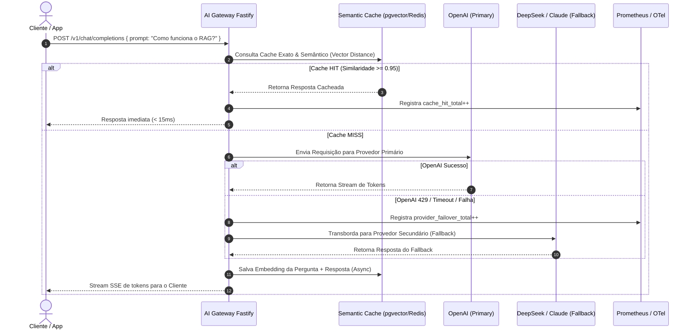

# 🛡️ Enterprise AI Gateway & Semantic Cache — High-Throughput LLM Proxy

<p align="center">
  
</p>

<p align="center">
  <strong>Production-ready, ultra-low latency AI Gateway & Semantic Vector Cache engineered with Node.js, Fastify, TypeScript, Redis, pgvector, and OpenTelemetry.</strong>
</p>

<p align="center">
  <a href="#-architecture--traffic-flow"></a>
  <a href="#-core-capabilities"></a>
  <a href="LICENSE"></a>
</p>

<p align="center">
  
  
  
  
  
  
  
</p>

---

## 📌 Visão Geral & Proposta de Valor

O **AI Gateway & Semantic Cache** é um proxy inteligente e de alta performance posicionado entre as suas aplicações corporativas e os provedores de Modelos de Linguagem (LLMs). Ele resolve os maiores gargalos de operações de IA em escala: **custos exorbitantes com APIs**, **latência elevada** e **indisponibilidade / rate limits de provedores individuais**.

### 🚀 Destaques do Projeto:
- **Cache Semântico Vetorial (Vector Caching)**: Armazena embeddings de perguntas anteriores. Perguntas com similaridade semântica $\ge 0.95$ são respondidas em **< 15ms** sem consumir tokens de LLMs externas (redução de até 80% nos custos).
- **Multi-Provider Dynamic Fallback**: Roteamento automático em cascata: `OpenAI -> Anthropic Claude -> DeepSeek -> Ollama Local (On-Premise)`. Se a OpenAI cair ou bater rate-limit 429, a requisição transborda instantaneamente sem quebrar o cliente.
- **Circuit Breaker & Load Balancing**: Monitoramento de saúde dos provedores com proteção contra cascading failures.
- **Granular Token Rate Limiter & Budget Control**: Limite de chamadas por usuário, departamento ou API Key.
- **Full Observability & Audit**: Métricas em tempo real com **Prometheus**, rastreamento distribuído via **OpenTelemetry** e logs de auditoria em JSON estruturado com **Pino**.

---

## 🏛️ Arquitetura do Sistema (Traffic & Cache Flow)

```text
+---------------------------------------------------------------------------------------------------------+
|                                  CLIENT APPLICATIONS / FRONTENDS / APIS                                 |
+---------------------------------------------------------------------------------------------------------+
                                                     │
                                                     │ POST /v1/chat/completions (OpenAI Compatible)
                                                     ▼
+---------------------------------------------------------------------------------------------------------+
|                                    ENTERPRISE AI GATEWAY (Fastify)                                      |
|                                                                                                         |
|   • Auth & Rate Limiter (Zod)         • Token Budget Tracker        • OpenTelemetry Spans & Metrics     |
+---------------------------------------------------------------------------------------------------------+
                                                     │
                                                     ▼
                                        ┌─────────────────────────┐
                                        │  EXACT / SEMANTIC CACHE │
                                        └─────────────────────────┘
                                           │                   │
                            Exact Hit (L1) │                   │ Semantic Similarity >= 0.95 (L2)
                                           ▼                   ▼
                          +───────────────────────+   +───────────────────────+
                          |   Redis Exact Cache   |   |  pgvector Cosine Sim  |
                          |     Latency < 3ms     |   |     Latency < 15ms    |
                          +───────────────────────+   +───────────────────────+
                                           │                   │
                     Cache HIT (Return cached response without LLM API call) ───► Fast Client Response
                                           │
                                           │ Cache MISS (Similarity < 0.95)
                                           ▼
+---------------------------------------------------------------------------------------------------------+
|                                 DYNAMIC PROVIDER ROUTER & FALLBACK POOL                                 |
|                                                                                                         |
|       1. Primary: OpenAI (GPT-4o) ──(On 429 / 5xx Timeout)──► 2. Fallback: Anthropic (Claude 3.5)       |
|                                                                         │ (On Error)                    |
|                                                                         ▼                               |
|       4. On-Premise: Ollama (Llama 3 Local) ◄──(On Error)── 3. Fallback: DeepSeek API (V3 / R1)         |
+---------------------------------------------------------------------------------------------------------+
                                                     │
                                                     ▼
+---------------------------------------------------------------------------------------------------------+
|                                ASYNC CACHE POPULATION & TELEMETRY LOG                                   |
|               Armazena novo par (Embeddings + Resposta) no Cache Vetorial e emite métricas              |
+---------------------------------------------------------------------------------------------------------+
```

---

## 📊 Tabela de Módulos & Estratégia de Cache

| Camada | Tecnologia | Latência Média | Redução de Custo | Descrição |
|---|---|---|---|---|
| **L1: Exact Match** | `Redis String Key` | **< 3ms** | 100% | Hash SHA-256 do prompt para respostas idênticas. |
| **L2: Semantic Match** | `pgvector Cosine Sim` | **< 15ms** | 100% | Similaridade de cosseno vetorial para perguntas análogas. |
| **L3: LLM Inference** | `OpenAI / Claude / Ollama` | **1200ms - 3500ms** | 0% | Chamada real à API com streaming SSE token a token. |

---

## 🧠 Ciclo de Vida da Requisição (Sequence Diagram)



---

## 🛠️ Tech Stack & Dependências

- **Runtime**: Node.js 20+ & TypeScript 5.x
- **HTTP Engine**: Fastify com suporte a compatibilidade com a API da OpenAI (`/v1/chat/completions`)
- **Cache Semântico**: PostgreSQL 16 + pgvector & Redis 7
- **Embeddings de Cache**: OpenAI `text-embedding-3-small` / Ollama `bge-m3`
- **Observabilidade**: Pino JSON, Prometheus `/metrics`, OpenTelemetry
- **Resiliência**: Fallback router, Circuit Breaker e `@fastify/rate-limit`

---

## ⚙️ Quickstart & Instalação

```bash
git clone https://github.com/dev-rodrigues00/OPENSOUNCER-ai-gateway-node.git
cd ai-gateway-cache-node
npm install
docker compose up -d
npm run dev
```

---

## 🛡️ Licença

Distribuído sob a licença **MIT Open Source**. Consulte o arquivo [LICENSE](LICENSE) para mais detalhes.

---

<p align="center">
  <sub>Construído por <strong>Dev Rodrigues</strong> • AI Gateway & Semantic Cache Engine 2026. 🚀</sub>
</p>
